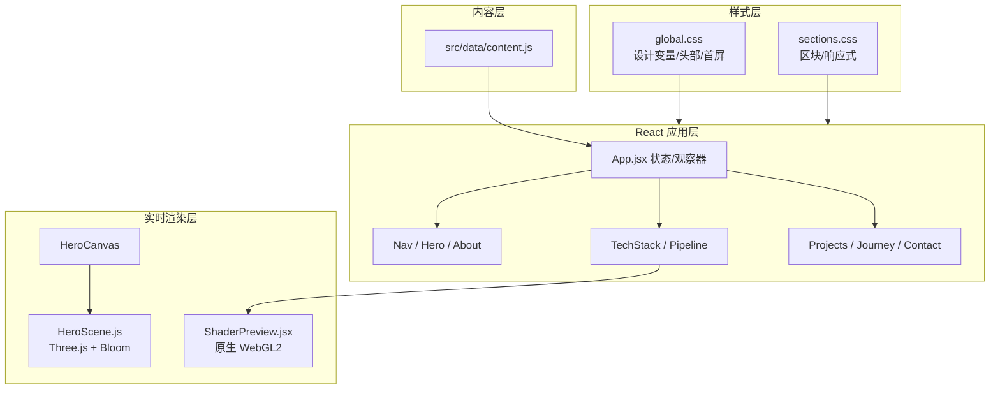

# 林屿 · 个人主页 — 详细技术栈

> 文档版本：2026-10-28  
> 对应代码：当前仓库默认分支 `master`（workflow 同时兼容 `main` / `master`）  
> 配套文档：[README.md](README.md)（启动、部署、质检速查）  
> 读者对象：项目维护者、协作者、技术面试官

本文档解释这个个人主页**为什么这样实现**、**每个技术点在代码里的位置**，以及**性能、可访问性和部署**上的取舍。README 负责“怎么跑”，本文负责“为什么这样跑”。

---

## 目录

- [1. 项目概览](#1-项目概览)
- [2. 技术栈总览](#2-技术栈总览)
- [3. 系统架构](#3-系统架构)
- [4. React 架构与状态](#4-react-架构与状态)
- [5. Three.js 主视觉](#5-threejs-主视觉)
- [6. 原生 WebGL / GLSL 演示](#6-原生-webgl--glsl-演示)
- [7. 视觉系统与 CSS](#7-视觉系统与-css)
- [8. 交互实现](#8-交互实现)
- [9. 可访问性](#9-可访问性)
- [10. 性能预算](#10-性能预算)
- [11. 质量保证](#11-质量保证)
- [12. GitHub Pages 部署](#12-github-pages-部署)
- [13. 目录结构](#13-目录结构)
- [14. 技术选型取舍](#14-技术选型取舍)
- [15. 已知限制与后续计划](#15-已知限制与后续计划)
- [16. 参考](#16-参考)

---

## 1. 项目概览

一个纯静态、单页面的个人作品集，用**真实运行的 WebGL** 展示图形渲染能力，同时用完整的工程化配置证明它不只是“能打开的页面”。

核心目标有三个：

1. **集中展示技术栈**：Java、Go、OpenGL、WebGL / Three.js、Blender、GLSL、React / TypeScript 各自有对应的内容位置，而不是堆砌 logo。
2. **把渲染当作品**：首页的粒子场景不是视频，而是 Three.js 实时计算；渲染管线区块里还有一段用原生 WebGL 跑的 GLSL 极光。
3. **可维护、可部署**：所有内容集中在一个数据文件；构建、质检、GitHub Pages 部署都有可重复的脚本与配置。

| 指标 | 数值 |
| --- | --- |
| 页面形态 | 单页、纯静态、无后端 |
| 首屏视觉 | Three.js 0.186 + 后处理 Bloom |
| 原生图形演示 | WebGL2（WebGL1 回退）+ GLSL FBM |
| 构建产物 | JS ≈ 845 KB（gzip ≈ 228 KB），CSS ≈ 50 KB（gzip ≈ 13 KB） |
| 第三方 UI 框架 | 无 |
| 页面图片依赖 | 无（5 张项目封面均为程序化 SVG） |
| 部署 | GitHub Pages + GitHub Actions |
| 可访问性 | axe-core WCAG A/AA 扫描 0 违规（桌面 / 移动端） |

---

## 2. 技术栈总览

### 2.1 依赖版本

| 层级 | 技术 | 版本 | 用途 |
| --- | --- | --- | --- |
| 运行时 | Node.js | `^20.19.0 \|\| >=22.12.0` | Vite 8 要求；CI 使用 22，本地为 24.22.1 |
| 包管理 | npm | 11.x | `package-lock.json` 锁定依赖 |
| 构建 | Vite | 8.3.5 | 开发服务器、生产构建（Rolldown） |
| UI 框架 | React | 19.3.1 | 组件、状态、副作用 |
| 3D 引擎 | Three.js | 0.186.1 | 场景图、粒子、后处理 |
| 3D 后处理 | Three.js Addons | 随 Three 版本 | EffectComposer / UnrealBloomPass / OutputPass |
| 图标 | 内联 SVG | — | 无图标库依赖 |
| 字体 | Fontsource Variable | 5.3.0 | Space Grotesk Variable、JetBrains Mono Variable |
| 样式 | 原生 CSS | — | CSS Variables、Grid/Flex、媒体查询 |
| 测试 | Puppeteer Core | 25.x | 截图与交互回归 |
| 可访问性测试 | axe-core | 4.14 | WCAG A/AA 扫描 |
| 部署 | GitHub Actions | — | 构建并发布到 GitHub Pages |

### 2.2 语言与工程约束

- **React + JavaScript (JSX)**：没有引入 TypeScript 编译链，保持构建简单、依赖少。数据模块与组件边界依靠约定与代码审查保证。
- **ES Modules**：`package.json` 声明 `"type": "module"`，Vite 配置、工具脚本都用 ESM。
- **构建目标 `es2020`**：覆盖现代常青浏览器，同时避免为旧浏览器输出过重 polyfill。
- **无路由**：单页 + 锚点导航，不需要 React Router，也不需要服务端 rewrite 规则。

---

## 3. 系统架构



数据流的关键点：

- `content.js` 是唯一内容源；组件只负责渲染与交互。
- `App` 持有三个全局状态：`activeTech`、`activeSection`、`loading`，把首屏 3D 标签、技术栈面板、导航高亮串起来。
- 渲染层与 UI 层解耦：`HeroScene` 是一个普通类，不依赖 React；`HeroCanvas` 只负责挂载与销毁。

---

## 4. React 架构与状态

### 4.1 组件树

| 组件 | 职责 | 关键实现 |
| --- | --- | --- |
| `App` | 组合页面、导航状态、滚动显现、加载态 | IntersectionObserver，loading 回调 |
| `Nav` | 顶部导航、滚动进度条、移动端菜单 | rAF 节流 scroll，Escape 关闭，`aria-expanded` |
| `Hero` | 首屏文案、CTA、数据、HUD | CSS 入场动画 |
| `HeroCanvas` | Three.js 生命周期桥接 | `useRef` + `useEffect` + `setActiveTech` |
| `Marquee` | 技术关键词滚动条 | 双份内容 + CSS 位移 |
| `About` | 自我介绍、Bento 卡片、三条原则 | `data-reveal` |
| `TechStack` | 七个技术 tab、熟练度环 | roving tabindex、方向键、hover 仅桌面 |
| `Pipeline` | OpenGL 六阶段、代码卡 | 数据驱动 + 高亮 token |
| `ShaderPreview` | 实时 GLSL 极光 | WebGL2/1、编译链接错误处理 |
| `Projects` | 五张项目卡 | 指针倾斜、聚光、外链 |
| `ProjectVisual` | 程序化 SVG 封面 | 5 种视觉（terrain / nebula / forge / network / ledger） |
| `Journey` | 时间线 | 语义化 `ol/li` |
| `Contact` | 邮件、社交、状态 | `mailto:` 与 `aria` |
| `Footer` | 大字字标、版权、回顶 | 描边文字 |
| `Cursor` | 自定义光标 | 仅 fine pointer；rAF 插值 |
| `Loader` | 首屏加载动画 | 进度、遮罩、滚动锁定 |
| `Icon` | 统一线性图标 | 内联 SVG，`aria-hidden` |

### 4.2 状态模型

```js
// App.jsx
const [activeTech, setActiveTech] = useState(null)      // 首屏 3D 标签高亮
const [activeSection, setActiveSection] = useState('top') // 导航当前区块
const [loading, setLoading] = useState(true)             // Loader 是否挂载
```

- `activeTech` 初始为 `null`，首屏因此显示全部技术标签；在技术栈区块选择后，同步给 `HeroScene.setActiveTech()`。
- `TechStack` 的展示回退值是 `webgl`，即使 `activeTech` 为空也能看到默认详情。
- 不使用 Redux / Zustand：状态只有三个，提升到根组件即可，避免为单页引入全局状态库。

### 4.3 副作用与生命周期

| 副作用 | 位置 | 说明 |
| --- | --- | --- |
| 滚动显现 | `App` | `[data-reveal]` + IntersectionObserver，出现一次即取消观察；`prefers-reduced-motion` 下直接全部显示 |
| 导航高亮 | `App` | 观察 6 个 section，`rootMargin: -42% / -52%` 取视口中线附近 |
| hash 变化 | `App` | 回到 `#top` 时重置导航状态 |
| 滚动进度 | `Nav` | rAF 节流，直接写 `transform: scaleX()`，不触发 React 重渲染 |
| 加载锁 | `Loader` | `html.is-loading` 禁止滚动；完成后移除 |
| 移动菜单锁 | `Nav` | `html.is-menu-open`，Escape 关闭，组件卸载时清理 |
| Three.js | `HeroCanvas` | 挂载 `new HeroScene()`，卸载 `destroy()`；构造异常时启用 CSS 兜底 |
| WebGL 演示 | `ShaderPreview` | 自行管理 context、program、buffer、观察器与清理 |

### 4.4 无路由的锚点导航

- 每页 `section` 带 `id`，导航使用原生 `href="#id"`。
- `html { scroll-behavior: smooth; scroll-padding-top: calc(var(--nav-height) + 24px); }` 保证固定头部不遮住标题。
- 移动菜单点击后先关闭菜单，浏览器默认锚点滚动生效。已用 Puppeteer 验证：滚动位置正确，菜单关闭，`aria-expanded` 恢复 `false`。

### 4.5 内容数据层

`src/data/content.js` 导出：

| 导出 | 用途 |
| --- | --- |
| `profile` | 姓名、角色、首屏文案、状态、坐标、邮箱、社交、数据、导航 |
| `marquee` | 滚动技术词 |
| `techStack` | 7 项技术：名称、分类、熟练度、年限、颜色、描述、标签 |
| `aboutCards` / `principles` | 关于区块 |
| `pipeline` | 渲染管线 6 个阶段 |
| `projects` | 5 个项目：封面类型、强调色、指标、技术标签、外链 |
| `journey` | 时间线 |
| `contact` | 联系区块标题与说明 |

所有文案与项目数据只在这一处修改；组件不硬编码个人内容。

---

## 5. Three.js 主视觉

代码位置：[`src/three/HeroScene.js`](src/three/HeroScene.js)

### 5.1 渲染器与后处理

```js
new THREE.WebGLRenderer({
  canvas,
  alpha: true,
  antialias: true,
  powerPreference: 'high-performance',
})
renderer.setPixelRatio(Math.min(devicePixelRatio, 1.8))
renderer.toneMapping = THREE.ACESFilmicToneMapping
renderer.toneMappingExposure = 1.05
renderer.outputColorSpace = THREE.SRGBColorSpace
renderer.setClearColor(0x000000, 0)
```

后处理链：

```text
RenderPass → UnrealBloomPass(strength 0.85, radius 0.6, threshold 0.12) → OutputPass
```

- 使用 `EffectComposer` 而不是直接 `renderer.render`，以获得辉光（Bloom）并保证色调映射/色彩空间正确。
- `alpha: true` 让首屏画布与 CSS 背景光晕叠加，形成更深的层次。
- DPR 上限 1.8，避免 3x/4x 屏幕上像素爆炸。

### 5.2 场景图与粒子预算

```text
Scene
├── stars        Points × 1,700（半径 7–24）
└── rig
    ├── core
    │   ├── knot        Points × 2,600（TorusKnot 采样）
    │   ├── cage        TorusKnot wireframe
    │   ├── glow        CanvasTexture Sprite
    │   ├── ico         Icosahedron 实体
    │   └── icoWire     Icosahedron 线框
    ├── rings
    │   ├── 3 × Torus（不同半径/倾角）
    │   └── outer       Icosahedron wireframe（半径 2.05）
    ├── labelGroup      7 × Sprite（JAVA / GO / OPENGL / WEBGL / BLENDER / GLSL / REACT）
    └── dust        Points × 900（半径 3.2–6.8）
```

实现细节：

| 元素 | 实现 |
| --- | --- |
| 粒子结 | `TorusKnotGeometry(1.42, 0.44, 260, 40, 2, 3)` 采样为 2,600 个点，加 0.035 抖动，顶点色从青到紫、局部混合琥珀 |
| 点材质 | 共享 64×64 径向渐变 CanvasTexture，加色混合（AdditiveBlending），避免方点 |
| 核心 | Icosahedron + 线框外壳 + 中心高光 Sprite |
| 轨道 | 三个 Torus 环 + 外围 Icosahedron 线框，分别以不同速度反向旋转 |
| 标签 | 512×128 CanvasTexture，含圆点/描边/等宽文字；`depthTest: false` 保证不被粒子遮挡 |
| 星场 | 球壳均匀采样，颜色在青/紫/白之间随机 |

### 5.3 动画与交互

- `requestAnimationFrame` 驱动，delta 上限 0.05s，避免切回标签页时跳帧。
- 首屏入场：`easeOutCubic` 1.6s，粒子结从 0.72 缩放到 1，透明度渐入。
- 鼠标视差：指针归一化后线性插值（0.045），影响相机、场景组和标签组；不使用 React state。
- 标签浮动：每个标签有 `baseY`，用 `sin(time + index)` 做 ±0.045 的上下浮动。
- 技术标签高亮：`setActiveTech(key)` 将其他标签降到 0.28 透明度，当前标签放大到 1.38 倍。
- 滚动联动：滚出首屏时相机后移、场景整体下移、Bloom 减弱。

### 5.4 相机与响应式

| 参数 | 桌面 | 窄屏（< 900px） |
| --- | --- | --- |
| FOV | 42° | 52°（< 768px） |
| 相机 Z | 9.6 | 9.6（滚动时 +2.6） |
| 场景 X | 2.0（视觉在右侧） | 0（居中） |
| 场景缩放 | 1.0 | 0.62 |
| 技术标签 | 显示 | 隐藏（避免压住文字） |
| Canvas 透明度 | 1 | 0.62 + 更强暗角 |

移动端把 3D 降为背景氛围，文字可读性优先。

### 5.5 性能与生命周期

1. **只渲染需要的帧**：`scrollY > 1.7 × innerHeight` 或页面隐藏时暂停 rAF；回到首屏再恢复。
2. **像素上限**：DPR 1.8；后处理 composer 使用同一像素比。
3. **减少状态更新**：Three.js 动画完全绕开 React；`setActiveTech` 只改材质参数。
4. **资源释放**：`destroy()` 遍历场景，释放 geometry / material / texture，并销毁 composer、renderer、事件监听。
5. **Reduced motion**：`prefers-reduced-motion: reduce` 时只渲染一帧静态画面（`elapsed = 2` 完成入场）。
6. **WebGL 不可用**：`HeroCanvas` 捕获构造异常，给 canvas 加 `.is-unavailable`，用 CSS 径向渐变兜底，页面其他部分不受影响。

---

## 6. 原生 WebGL / GLSL 演示

代码位置：[`src/components/ShaderPreview.jsx`](src/components/ShaderPreview.jsx)

这一块刻意不用 Three.js，用来展示对图形管线的直接控制。

### 6.1 上下文与兼容

```js
const gl =
  canvas.getContext('webgl2', { alpha: false, antialias: false, powerPreference: 'low-power' }) ||
  canvas.getContext('webgl', { alpha: false, antialias: false, powerPreference: 'low-power' })
```

- 优先 WebGL2，失败回退 WebGL1。
- 着色器使用 GLSL ES 1.00 语法（`attribute` / `gl_FragColor`，不写 `#version`），因此同一份源码可以同时跑在两条路径上。
- 所有编译/链接错误都会打印到控制台并安全退出，不会阻塞 React。

### 6.2 全屏三角形

只上传 3 个顶点：

```js
gl.bufferData(gl.ARRAY_BUFFER, new Float32Array([-1, -1, 3, -1, -1, 3]), gl.STATIC_DRAW)
```

比全屏四边形少一次三角形，也避免对角线接缝，是后处理/全屏着色器的标准做法。

### 6.3 片元着色器数学

- 5 层 FBM（Fractal Brownian Motion）噪声：`hash → noise → fbm`。
- 两个方向的低频域扭曲，形成流动的极光/星云。
- 颜色在深蓝、青、紫、琥珀之间按噪声插值，再叠加中心暖色光晕与暗角。
- `pow(col, vec3(0.88))` 轻微提亮；输出为不透明像素。

参数（`uTime`、`uRes`）由 JS 每帧写入；移动端 DPR 上限 1.5。

### 6.4 调度与降级

- 进入视口才启动渲染（`IntersectionObserver`, threshold 0.05）。
- 页面隐藏暂停；窗口 resize 时重新设置 viewport。
- `prefers-reduced-motion` 下只渲染一帧（固定 `uTime = 4.2`），保留静态极光。
- WebGL 不可用时给 canvas 加 `.is-unavailable`，显示 CSS 渐变兜底。
- 卸载时删除 buffer / program / shaders，并断开观察器与事件。

---

## 7. 视觉系统与 CSS

样式文件：

- [`src/styles/global.css`](src/styles/global.css)：设计变量、重置、Loader、导航、Hero、滚动条、Marquee、Footer、自定义光标、噪点、关键帧。
- [`src/styles/sections.css`](src/styles/sections.css)：区块标题、关于、技术栈、渲染管线、项目、历程、联系、响应式断点。

### 7.1 设计变量（部分）

| 变量 | 值 | 用途 |
| --- | --- | --- |
| `--bg` | `#05060a` | 页面底色 |
| `--text` | `#eef1f7` | 主文字 |
| `--muted` | `#939cb0` | 次级文字 |
| `--muted-2` | `#6f798e` | 辅助说明/标签 |
| `--cyan` | `#5eead4` | 状态、强调 |
| `--ice` | `#6ee7ff` | 主高光 |
| `--violet` | `#a78bfa` | 渐变、图形 |
| `--amber` | `#ffb26b` | Java / 暖色强调 |
| `--container` | `1200px` | 内容宽度 |
| `--nav-height` | `78px`（移动端 68px） | 固定导航高度 |

字体：

```css
--font-display: 'Space Grotesk Variable', 'Space Grotesk', 'HarmonyOS Sans SC', 'PingFang SC', 'Microsoft YaHei', sans-serif;
--font-mono: 'JetBrains Mono Variable', 'JetBrains Mono', 'Cascadia Code', Consolas, monospace;
```

拉丁字符使用本地打包的可变字体，中文回退到系统字体；不请求 Google Fonts，离线可用。

### 7.2 布局与响应式

| 断点 | 主要变化 |
| --- | --- |
| `max-width: 1560px` | 隐藏首屏右侧竖排 HUD |
| `max-width: 1120px` | 技术栈行精简列 |
| `max-width: 980px` | 导航折叠、移动菜单、单列布局、技术详情置顶 |
| `max-width: 860px` | 首屏 3D 降透明度、项目卡 2 列、时间线调整 |
| `max-width: 720px` | 容器收窄、单列项目、统计 2 列、页脚堆叠 |
| `max-width: 480px` | 字号/按钮/滚动提示等细节 |

- 首屏使用 `100svh`，避免移动端浏览器地址栏导致的高度跳动。
- 字号、间距大量使用 `clamp()`，在 390px–1920px 之间连续缩放。
- 项目区使用 12 列 Grid，形成 7/5、5/7 的错落布局；第五张 Java 项目为通栏卡。

### 7.3 质感细节

- 径向渐变 + 网格遮罩（`mask-image`）营造空间感。
- 噪点由内联 SVG `feTurbulence` 生成，`mix-blend-mode: overlay`。
- 项目封面全部为代码绘制的 SVG（地形线框、点云、等距立方体、服务网络、交易账本）。
- 文字描边（`-webkit-text-stroke`）用于页脚大字标；渐变文字用于首屏第三行与联系标题。
- 卡片使用半透明渐变、细边框和 hover 聚光；项目卡根据指针位置设置 `--rx/--ry` 做轻微 3D 倾斜。

---

## 8. 交互实现

| 交互 | 实现要点 |
| --- | --- |
| 自定义光标 | 仅 `(pointer: fine)` 且非 reduced-motion；dot 立刻跟随，ring 用 rAF 插值；悬停交互元素时放大 |
| 滚动进度条 | `transform: scaleX(scrollY / maxScroll)`，rAF 节流 |
| 导航高亮 | IntersectionObserver 监听 6 个 section，中线附近判断 |
| 移动菜单 | 独立于 header 的 fixed 层，避免祖先建立包含块；锁定滚动、Escape 关闭、点击链接关闭 |
| 技术栈切换 | 点击 / 聚焦 / 桌面 hover；`role=tablist` + roving `tabIndex`；方向键 / Home / End 切换；面板 `aria-live` |
| 项目卡 | `pointermove` 计算相对坐标 → CSS 变量 → `rotateX/rotateY` + 聚光位置；触屏不启用倾斜 |
| 滚动显现 | IntersectionObserver + `data-reveal`，只触发一次 |
| 加载动画 | 1500ms 进度（reduced-motion 500ms），淡出 650ms，期间锁定滚动 |
| 响应式菜单 | `aria-expanded` / `aria-controls` / `hidden` 同步；菜单链接使用原生锚点 |

一个容易踩的布局细节：宽屏下技术详情在右侧 sticky，高度变化不影响左侧列表；窄屏下详情被 `order: -1` 放到列表上方，此时如果继续用 hover 切换，列表会从指针下方移动并触发新的 hover，形成抖动。因此 hover 选择只在 `window.innerWidth >= 981` 时启用，触屏与键盘不受影响。

---

## 9. 可访问性

已落实的检查项：

- 语义化结构：`header`、`nav`、`main`、`section`、`article`、`ol/li`、`footer`。
- 跳过导航链接（`.skip-link` → `#main`）。
- 所有交互元素可键盘访问，`:focus-visible` 有可见轮廓。
- 技术栈使用标准 tabs 语义：`role=tablist/tab/tabpanel`、`aria-selected`、`aria-controls`、`aria-labelledby`、roving tabindex。
- 移动菜单按钮维护 `aria-expanded` 与 `aria-controls`；Escape 关闭。
- 所有装饰性 Canvas / SVG / 粒子设置 `aria-hidden`；图标 `aria-hidden`。
- `prefers-reduced-motion`：关闭入场/位移/滚动动画，显示全部内容；Three.js 只渲染静态帧。
- WebGL 不可用时页面仍可阅读（CSS 兜底）。
- 颜色对比：正文与辅助文字在深色底上保持可读；axe-core WCAG A/AA 扫描桌面与移动端均为 **0 violations**。

键盘路径：

```text
Tab → Skip link → Logo → 导航 → CTA → 首屏按钮 → 技术栈 tabs（方向键切换）→ 项目链接 → 联系链接 → 页脚
```

---

## 10. 性能预算

### 10.1 构建产物体积

| 资源 | 原始 | gzip |
| --- | --- | --- |
| JS（单 chunk） | ≈ 845 KB | ≈ 228 KB |
| CSS | ≈ 50 KB | ≈ 13 KB |
| 字体（woff2，按需加载子集） | ≈ 132 KB 全量 | — |
| favicon | 0.9 KB | — |
| OG 封面 | 123 KB | — |

浏览器通常只加载 Latin 字体子集（Space Grotesk ≈ 22 KB + JetBrains Mono ≈ 40 KB）。首屏实际网络传输约 **300 KB gzip 量级**（不含 OG 图，Social 抓取时才会请求）。

### 10.2 运行性能策略

- Three.js 场景在滚出首屏后暂停，避免长页后台消耗 GPU。
- 原生着色器只在进入视口且页面可见时运行。
- DPR 上限：Three.js 1.8，原生 WebGL 1.5。
- 不使用阴影贴图、实时反射、外部 HDR；粒子颜色全部由顶点色/程序纹理产生。
- 点云共用一张 64×64 纹理；标签也只有 7 张 512×128 canvas 纹理。
- 动效以 CSS transform/opacity 为主，避免触发布局。
- 事件监听使用 `{ passive: true }`；滚动进度用 rAF 节流。
- 所有 Canvas / WebGL 资源在组件卸载时释放。

### 10.3 为什么暂时不做代码分割

Three.js 与后处理是首屏核心，拆成异步 chunk 只会增加一次网络往返和加载态复杂度。当前单个 chunk 约 228 KB gzip，在可接受范围。若未来引入更多 3D 页面或重量级依赖，再按路由/区块做 `dynamic import`。

---

## 11. 质量保证

开发辅助脚本位于 `tools/`（需要本地 Chrome，脚本顶部可改路径）：

| 脚本 | 覆盖内容 |
| --- | --- |
| `tools/shoot.mjs` | 桌面 1440×900、宽屏 1920×1080、移动 390×844 的区块截图；项目卡与移动菜单状态 |
| `tools/interact.mjs` | 移动菜单开合与锚点跳转、技术 tab 点击与方向键、横向溢出（390/768/1024/1440）、reduced-motion、运行时错误 |
| `tools/audit-a11y.mjs` | axe-core WCAG A/AA 扫描（桌面 + 移动端） |

最近一次结果：

- 交互检查：**10 / 10 PASS**
- 控制台：**无报错、无警告**
- axe-core：**桌面 0 违规 / 移动端 0 违规**
- 生产构建：通过
- GitHub Pages 子路径 `/selfpage/` 实测：通过（含交互测试）

命令行：

```bash
npm run dev
node tools/shoot.mjs
node tools/interact.mjs
node tools/audit-a11y.mjs

# 对生产预览做同样检查
$env:PREVIEW_URL='http://127.0.0.1:4173/'; node tools/interact.mjs
```

> 截图与 QA 脚本依赖本机 Chrome 和 `puppeteer-core` / `axe-core`，属于开发依赖，不影响生产包。

---

## 12. GitHub Pages 部署

### 12.1 工作流

文件：[`.github/workflows/deploy.yml`](.github/workflows/deploy.yml)

触发条件：

- push 到 `main` / `master`
- 手动 `workflow_dispatch`

权限与并发：

```yaml
permissions:
  contents: read
  pages: write
  id-token: write

concurrency:
  group: pages
  cancel-in-progress: false
```

部署步骤：

| 步骤 | Action | 说明 |
| --- | --- | --- |
| Checkout | `actions/checkout@v7` | 拉取代码 |
| Setup Node | `actions/setup-node@v7` | Node 22 + npm 缓存 |
| Install | `npm ci` | 严格按 lockfile 安装 |
| Resolve base | shell | 计算 `VITE_BASE` |
| Build | `npm run build` | Vite 构建到 `dist/` |
| Setup Pages | `actions/configure-pages@v6` | 配置 Pages 环境 |
| Upload | `actions/upload-pages-artifact@v5` | 上传 `dist/` |
| Deploy | `actions/deploy-pages@v5` | 发布并输出 `page_url` |

### 12.2 base path 自动解析

GitHub Pages 的 URL 形式决定 Vite 的 `base`，否则会出现 JS/CSS 404 或白屏。工作流按以下优先级计算：

| 场景 | 结果 |
| --- | --- |
| 项目页 `https://<user>.github.io/<repo>/` | `/<repo>/` |
| 用户/组织页 `https://<user>.github.io/`（仓库名 `*.github.io`） | `/` |
| 自定义域名（存在 `public/CNAME` 或根目录 `CNAME`） | `/` |
| 仓库变量 `PAGES_BASE`（如 `/docs/`） | 覆盖为指定值 |

脚本还会补全首尾 `/`，写入 `GITHUB_ENV`，随后 `npm run build` 读取 `process.env.VITE_BASE`。

### 12.3 首次部署

1. 将代码推送到 GitHub，默认分支为 `main` 或 `master`。
2. 仓库 **Settings → Pages → Build and deployment → Source** 选择 **GitHub Actions**。
3. 等待 Actions 完成，访问 `https://<用户名>.github.io/<仓库名>/`。
4. workflow 同时监听 `main` 与 `master`；其他分支名请同步修改 `branches`。

### 12.4 自定义域名

方式 A（推荐）：在 `public/CNAME` 写入域名：

```text
www.example.com
```

Vite 会把 CNAME 复制到 `dist/`，工作流检测到后把 base 设为 `/`。

方式 B：仓库 **Settings → Secrets and variables → Actions → Variables** 新建 `PAGES_BASE`，值为 `/`（或自定义子路径如 `/docs/`）。

### 12.5 本地模拟 Pages 子路径

```bash
# macOS / Linux
VITE_BASE=/selfpage/ npm run build
npm run preview

# Windows PowerShell
$env:VITE_BASE='/selfpage/'; npm run build; npm run preview
```

已验证在该子路径下资源返回 200、交互与移动端测试全部通过。

### 12.6 常见问题

| 现象 | 原因 | 处理 |
| --- | --- | --- |
| 页面白屏、资源 404 | base 与部署路径不一致 | 查看 Actions 日志中的 `Using VITE_BASE=...`；自定义域名需 `public/CNAME` 或 `PAGES_BASE=/` |
| Actions 无法发布 | Pages Source 不是 GitHub Actions | Settings → Pages 改为 GitHub Actions |
| Node 引擎报错 | Node < 22.12 | workflow 已固定 Node 22，无需修改 |
| 部署后仍是旧页面 | 浏览器/Pages 缓存 | 等待 Actions 完成并强制刷新；确认工作流已成功 |
| 自定义域名 404 | 缺少 CNAME 或 DNS 未配置 | 配置 DNS，并确保 `public/CNAME` 存在 |

> `public/.nojekyll` 会随构建进入 `dist/`，确保 GitHub Pages 不把以下划线开头的构建产物当作 Jekyll 资源处理。

---

## 13. 目录结构

```text
.
├── .github/workflows/deploy.yml   # GitHub Pages 部署
├── .gitignore
├── index.html                     # base 占位符、SEO/OG/JSON-LD、noscript
├── package.json
├── package-lock.json
├── vite.config.js                 # base = VITE_BASE || '/'
├── README.md
├── 主页项目的详细技术栈.md          # 本文
├── public/
│   ├── .nojekyll
│   ├── favicon.svg
│   └── og-cover.jpg
├── src/
│   ├── main.jsx
│   ├── App.jsx
│   ├── data/content.js
│   ├── components/                # 17 个组件
│   ├── three/HeroScene.js         # Three.js 场景
│   └── styles/
│       ├── global.css
│       └── sections.css
├── tools/                         # 截图/交互/无障碍检查
└── dist/                          # 构建产物（git 忽略）
```

---

## 14. 技术选型取舍

| 选择 | 原因 | 代价 |
| --- | --- | --- |
| React 而非原生 DOM | 组件化、状态与副作用模型适合多区块交互 | 多约 60 KB 运行时（gzip 后更小） |
| Three.js 而非纯 WebGL 做首屏 | 场景图、Sprite、后处理生态成熟，开发效率高 | 包体较大，需要 code splitting 时才优化 |
| 另写原生 WebGL 演示 | 展示原始管线、编译链接、Uniform 管理与降级处理 | 额外维护一份渲染代码 |
| 原生 CSS 而非 Tailwind | 设计高度定制，CSS 变量 + 媒体查询足够；零构建依赖 | 需要自己维护 class 与响应式 |
| 单页无路由 | 内容结构简单，锚点即可 | 无法做多页面 SEO 拆分 |
| 无图片、SVG 程序化封面 | 加载快、风格统一、可无限缩放 | 单张封面表现力依赖代码而非摄影 |
| 内容集中在 `content.js` | 修改个人资料成本极低 | 项目多时文件会变长，可再拆模块 |
| 静态托管 | 无服务器成本、部署简单、全球 CDN | 无服务端能力（如需联系表单需第三方服务） |

---

## 15. 已知限制与后续计划

已知限制：

- **单 chunk 体积**：Three.js 与后处理全部打进主包，约 228 KB gzip；首屏加载动画已缓解感知，但仍有优化空间。
- **移动端 3D 标签隐藏**：为保证文字可读性，窄屏不显示环绕技术标签。
- **未做打印样式**：深色长页依赖滚动显现动画，打印/PDF 输出不是主要场景；如需可补 `@media print`。
- **占位身份信息**：姓名、公司、邮箱、项目链接均为示例，发布前必须替换。
- **OG 图路径**：使用 `%BASE_URL%` 根相对路径；若需社交平台绝对 URL，可在构建时注入站点域名。
- **无后端**：联系入口为 `mailto:`，没有表单、评论或访问统计。

后续可做：

1. 将 Three.js 场景改为 `dynamic import`，进一步降低首屏 JS。
2. 尝试 WebGPU 渲染器或 WebGPURenderer 作为渐进增强。
3. 引入 TypeScript 与内容 schema 校验。
4. 为项目详情增加独立的 Markdown/MDX 页面（若从单页扩展）。
5. 增加 CI 中的构建检查（如 PR 触发 `npm run build`）。
6. 用 Playwright 替代本机 Chrome 脚本，便于跨平台 CI。
7. 增加 `@media print` 与 Open Graph 绝对 URL 的构建注入。

---

## 16. 参考

- [Three.js 文档](https://threejs.org/docs/)
- [Three.js EffectComposer / UnrealBloomPass](https://threejs.org/examples/?q=bloom)
- [MDN WebGL 教程](https://developer.mozilla.org/zh-CN/docs/Web/API/WebGL_API/Tutorial)
- [WebGL2 规范](https://registry.khronos.org/webgl/specs/latest/2.0/)
- [Vite 静态部署指南](https://vite.dev/guide/static-deploy)
- [GitHub Pages 文档](https://docs.github.com/zh/pages)
- [actions/deploy-pages](https://github.com/actions/deploy-pages)
- [axe-core](https://github.com/dequelabs/axe-core)
- [Space Grotesk](https://fonts.google.com/specimen/Space+Grotesk) / [JetBrains Mono](https://www.jetbrains.com/lp/mono/)
